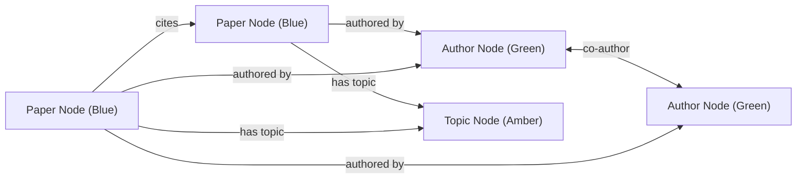

# Deliverable 1 — Context Document: Research Paper Library & Knowledge Graph

**Author:** ScholarGraph Engineering Team  
**Project:** Research Paper Library & Knowledge Graph  
**Deliverable Number:** 1 of 4  
**Date:** October 2026  

---

## Executive Summary

Academic research is expanding at an exponential rate, with millions of papers published annually across open-access repositories (such as arXiv) and peer-reviewed journals. For researchers, students, and practitioners, keeping pace with literature within any subdiscipline presents significant cognitive overload. 

Traditional reference managers often treat research papers simply as static PDF files with basic metadata attached. They lack automated semantic extraction, visual relationship mapping, and proactive cross-paper discovery. 

This document establishes the theoretical, domain, and technical context required to build the **ScholarGraph Research Paper Library & Knowledge Graph** application. It surveys the canonical anatomy of research publications, the intricacies of the Portable Document Format (PDF), bibliographic citation formats, automated tagging and topic modeling methodologies, graph-based knowledge representations, and the real-world engineering challenges inherent in parsing unstructured academic literature.

---

## 1. Anatomy and Structure of Research Papers

To build an automated extraction and indexing pipeline, the system must recognize the standard structural conventions of scientific publications. Most peer-reviewed scientific papers follow variations of the **IMRAD** model (Introduction, Methods, Results, and Discussion) organized into three distinct zones:

```
┌─────────────────────────────────────────────────────────────┐
│ 1. FRONT-MATTER                                             │
│    - Title                                                  │
│    - Authors, Affiliations, Corresponding Email Addresses   │
│    - Abstract (Condensed summary of problem, method, result)│
│    - Author Keywords / Index Terms                          │
│    - Metadata: Publication Venue, DOI, Date, Copyright      │
├─────────────────────────────────────────────────────────────┤
│ 2. BODY CONTENT (Canonical IMRAD Structure)                 │
│    - 1. Introduction & Background                           │
│    - 2. Related Work / Prior Art                            │
│    - 3. Methodology / System Architecture / Proofs          │
│    - 4. Empirical Evaluation / Results / Ablations          │
│    - 5. Discussion & Limitations                            │
│    - 6. Conclusion & Future Work                            │
├─────────────────────────────────────────────────────────────┤
│ 3. BACK-MATTER                                              │
│    - Acknowledgements & Funding Disclosures                 │
│    - References / Bibliography (Numbered or Author-Year)    │
│    - Appendices & Supplementary Materials                   │
└─────────────────────────────────────────────────────────────┘
```

### 1.1 Front-Matter Characteristics
- **Title**: Typically formatted with the largest font weight and size on the first page. It is positioned at the top of the page, either centered or flush-left. Titles may span 1 to 3 lines and occasionally end with subtitles demarcated by colons or em-dashes.
- **Authors and Affiliations**: Placed directly beneath the title. Author lists often feature superscripts (e.g., numbers or asterisks) referencing institutional departments, corporate research labs, or equal-contribution footnotes.
- **Abstract**: A self-contained paragraph (typically 150–300 words) summarizing the core contribution. It is demarcated by explicit headings such as `Abstract`, `A B S T R A C T`, or `Summary`.
- **Keywords / Index Terms**: A curated list of 3–8 categorical terms provided by authors to aid indexing in scientific databases (e.g., IEEE Xplore, ACM Digital Library).
- **Persistent Identifiers (DOIs)**: Digital Object Identifiers conforming to the `10.xxxx/...` standard, providing persistent URLs to the authoritative version of record.

### 1.2 Back-Matter and Bibliographies
The bibliography provides the foundation for citation analysis and knowledge graph construction. References appear under headings such as `References`, `Bibliography`, or `Literature Cited` and conform to strict grammatical patterns detailing author names, publication year, paper title, journal or conference name, volume, issue, and page ranges.

---

## 2. PDF Extraction: Mechanics and Technical Challenges

The Portable Document Format (PDF), created by Adobe Systems in 1993, is fundamentally a **presentation format**, not a semantic document tree. PDFs were designed to guarantee visual fidelity across diverse printer hardware and operating systems, which introduces significant friction when attempting automated data extraction.

### 2.1 The Nature of PDF Content Streams
A PDF document does not store paragraphs, tables, or semantic headings in a hierarchical structure like HTML (DOM) or Word (XML). Instead, it contains a low-level stream of drawing and text-positioning instructions:
```
BT
  /F1 18.0 Tf         % Select Font F1 at size 18pt
  72.0 720.0 Td       % Move coordinate to (X=72, Y=720)
  (Attention-Based) Tj % Draw text
  0 -22.0 Td          % Move down 22 units
  (Graph Neural Networks) Tj
ET
```
Because the PDF renderer treats characters as arbitrary glyphs placed at absolute geometric $(x, y)$ coordinates, extraction software must infer reading order, line grouping, and paragraph boundaries from spatial proximity.

### 2.2 Critical Extraction Challenges

```
┌─────────────────────────────────┬──────────────────────────────────────────────────────────────┐
│ Challenge                       │ Cause & Impact                                               │
├─────────────────────────────────┼──────────────────────────────────────────────────────────────┤
│ Two-Column & Multi-Column Layout│ Many papers (IEEE, ACM) format text in two parallel columns. │
│                                 │ Naive line-by-line reading combines column A and column B    │
│                                 │ horizontally into unintelligible interleaved sentences.      │
├─────────────────────────────────┼──────────────────────────────────────────────────────────────┤
│ Hyphenation & Line Wrapping     │ Words broken across lines (e.g. "trans- \nformer")           │
│                                 │ introduce artificial hyphens and line-break characters.      │
├─────────────────────────────────┼──────────────────────────────────────────────────────────────┤
│ Font Ligatures & Encoding       │ Common typographic ligatures ("fi", "fl", "ffi") are often  │
│                                 │ encoded as custom private unicode glyphs or control codes.   │
├─────────────────────────────────┼──────────────────────────────────────────────────────────────┤
│ Running Headers & Footers       │ Running heads (e.g., "arXiv:2403.0123v1 [cs.AI]") and page  │
│                                 │ numbers interrupt flow if not filtered from section text.   │
├─────────────────────────────────┼──────────────────────────────────────────────────────────────┤
│ Scanned / Image-Only PDFs       │ Documents produced by scanning print originals contain bitmap│
│                                 │ images without an underlying OCR text layer.                 │
├─────────────────────────────────┼──────────────────────────────────────────────────────────────┤
│ Corrupted or Truncated Files    │ Truncated downloads or zero-byte files cause stream parser   │
│                                 │ exceptions if not isolated by strict validation logic.       │
└─────────────────────────────────┴──────────────────────────────────────────────────────────────┘
```

### 2.3 Mitigation Architecture
Our extraction engine (`extractor.py`) implements a resilient multi-stage heuristic pipeline:
1. **Integrity Validation**: Computes cryptographic SHA-256 hash and verifies PDF magic bytes (`%PDF-`) and file size prior to deep parsing.
2. **Scanned PDF Fallback Detection**: Measures the ratio of extracted text volume to page count. If a multi-page document yields fewer than 80 characters, it flags the document as `scanned` to prevent parser failures while prompting the user.
3. **Hyphenation Correction**: Applies regular expressions `(\w+)-\s*\n\s*(\w+)` to reconstitute hyphenated words.
4. **Header Banner Suppression**: Filters initial preprint headers and running banners before extracting candidate titles.
5. **Boundary Segmentation**: Uses lookahead and lookbehind regular expressions to isolate abstracts and bibliographies between clearly identified section transitions.

---

## 3. Bibliographic Citation Formats

Scholarly disciplines employ distinct citation style manuals. The two primary paradigms are **numeric styles** and **author-date styles**.

### 3.1 Common Styles
- **IEEE Style (Numeric)**: Widely used in Computer Science and Electrical Engineering. In-text citations use bracketed numerals: `[1]`, `[2, 3]`.
  > *Example*: [1] A. Vaswani, N. Shazeer, et al., "Attention is all you need," in *Adv. Neural Inf. Process. Syst.*, 2017, pp. 5998–6008.
- **ACM Style (Numeric or Author-Year)**:
  > *Example*: [1] Kipf, T. N. and Welling, M. 2017. Semi-Supervised Classification with Graph Convolutional Networks. In *ICLR*.
- **APA Style (Author-Date)**: Pervasive in social sciences and cognitive computing:
  > *Example*: Vaswani, A., Shazeer, N., & Parmar, N. (2017). Attention is all you need. *Advances in Neural Information Processing Systems*, 5998–6008.

### 3.2 Citation Parsing and Cross-Linking
Extracting references serves a dual purpose:
1. **Cataloging Bibliographies**: Storing citations attached to each paper.
2. **Constructing Citation Edges**: When Paper $A$ cites Paper $B$, and Paper $B$ already exists inside the user's library, the system detects this relationship and creates a directional graph edge ($A \xrightarrow{\text{cites}} B$).

Our system extracts individual reference components (raw citation, candidate title, publication year, authors) and executes a cross-library reconciliation query to match references against titles indexed in the local database.

---

## 4. Automatic Tagging and Topic Categorization

Categorizing research publications allows researchers to browse collections efficiently and observe thematic overlaps. Manual tagging is labor-intensive; therefore, an automated approach is vital.

### 4.1 Hybrid Tagging Architecture
ScholarGraph utilizes a three-tier hybrid tagging strategy combining precision with domain breadth:

```
┌──────────────────────────────────────────────────────────────┐
│ Tier 1: Explicit Author Keywords                             │
│ Regex parser scans for "Keywords:", "Index Terms:"           │
│ Confidence: 0.95 (Highest precision, defined by authors)     │
└──────────────────────────────┬───────────────────────────────┘
                               ▼
┌──────────────────────────────────────────────────────────────┐
│ Tier 2: Domain Taxonomy Ontology Matching                    │
│ Predefined dictionary of 18+ Computer Science & AI domains   │
│ Regex pattern matching across Title, Abstract, Body          │
│ Confidence: 0.65 - 0.98 (Scaled by term frequency)           │
└──────────────────────────────┬───────────────────────────────┘
                               ▼
┌──────────────────────────────────────────────────────────────┐
│ Tier 3: Statistical Keyphrase Extraction                     │
│ Stopword filtering + Bi-gram & Unigram frequency scoring     │
│ Higher weights assigned to terms appearing in Title/Abstract │
│ Confidence: 0.50 - 0.85 (Discovers novel sub-topics)         │
└──────────────────────────────────────────────────────────────┘
```

### 4.2 Handling Academic Stopwords
Standard natural language stopwords (`the`, `and`, `with`) are insufficient for academic papers. Academic texts are replete with boilerplate verbs and nouns that carry little thematic distinction:
> `paper`, `approach`, `proposed`, `results`, `evaluates`, `framework`, `experiments`, `significant`, `et`, `al`, `figure`, `table`.

Our tagging engine utilizes an expanded **Academic Stopword Corpus** to filter out research boilerplate, ensuring only meaningful conceptual terms (e.g., `Self-Attention`, `Vector Search`, `Product Quantization`) are surfaced as tags.

---

## 5. Knowledge Graphs in Academic Research

A **Knowledge Graph** represents a network of real-world entities (nodes) and their semantic relationships (edges). In scientific literature management, representing data as a relational graph unlocks powerful discovery capabilities impossible with standard flat tables.

### 5.1 Graph Schema and Ontology
ScholarGraph models literature as a **Heterogeneous Multigraph** comprising three distinct node entity types and four relational edge types:



1. **Nodes**:
   - $\mathcal{V}_{\text{paper}}$: Identified by paper ID, labeled by paper title, styled with publication year, DOI, and citation degree.
   - $\mathcal{V}_{\text{author}}$: Identified by author name, sized proportionally to total authored papers in the library.
   - $\mathcal{V}_{\text{topic}}$: Identified by topic string, categorized into domains or techniques, sized by library occurrence frequency.

2. **Edges**:
   - $E_{\text{authorship}} \subseteq \mathcal{V}_{\text{paper}} \times \mathcal{V}_{\text{author}}$: Directional link from paper to its authors.
   - $E_{\text{topic}} \subseteq \mathcal{V}_{\text{paper}} \times \mathcal{V}_{\text{topic}}$: Link connecting papers to assigned topics.
   - $E_{\text{citation}} \subseteq \mathcal{V}_{\text{paper}} \times \mathcal{V}_{\text{paper}}$: Directional citation link ($P_i \rightarrow P_j$) indicating that paper $P_i$ cites paper $P_j$.
   - $E_{\text{coauthorship}} \subseteq \mathcal{V}_{\text{author}} \times \mathcal{V}_{\text{author}}$: Bidirectional dashed link connecting scholars who have co-authored publications within the library.

### 5.2 Force-Directed Physics Simulation
To render the graph intuitively without manual coordinate positioning, the frontend implements the **ForceAtlas2 / Barnes-Hut force-directed algorithm**:
- **Repulsive Coulomb Forces**: Nodes push away from one another like charged particles to prevent visual overlap.
- **Attractive Hooke's Law Springs**: Edges act like springs pulling connected nodes into proximity.
- **Stabilization Mechanism**: The system calculates positions iteratively until dynamic equilibrium is reached, after which physics can be frozen to ensure a stable layout.

---

## 6. Audit Trails and Reproducibility

Scientific workflows require transparency and traceability. When papers are cataloged, edited, retagged, or deleted, an audit trail records:
- The exact action code (`UPLOAD`, `EDIT`, `TAG_ADD`, `TAG_REMOVE`, `REF_ADD`, `REF_DELETE`, `DELETE`, `RE_EXTRACT`).
- The executing user and timestamp.
- The target paper and a structured modification delta.
- The capability to export this audit log to standard CSV formats for compliance and external verification.

---

## 7. Conclusion

By synthesizing multi-heuristic PDF parsing, domain taxonomy topic modeling, relational database persistence, and force-directed knowledge graph visualization, ScholarGraph transforms a disjointed collection of static PDF files into an interconnected, searchable, and interactive scholarly knowledge base. Deliverable 2 outlines the concrete architecture, database schema, API contracts, and implementation plan realizing this specification.
