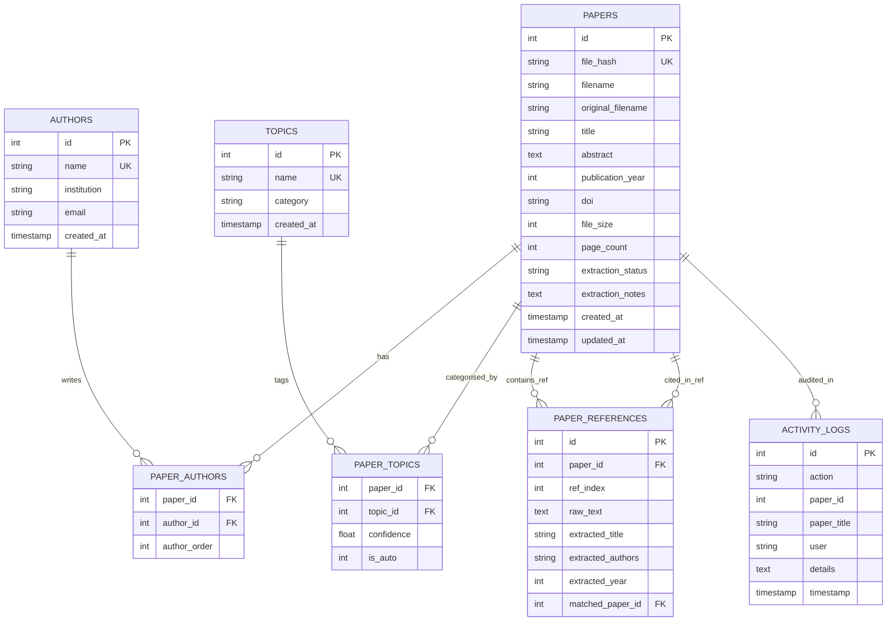

# Deliverable 2 — Plan and Prompts: System Architecture & Implementation Blueprint

**Author:** ScholarGraph Engineering Team  
**Project:** Research Paper Library & Knowledge Graph  
**Deliverable Number:** 2 of 4  
**Date:** October 2026  

---

## 1. System Technology Stack

The technology stack is selected to prioritize performance, maintainability, robust error tolerance, zero-configuration local deployment, and full offline functionality without external runtime dependencies.

```
┌────────────────────────────────────────────────────────────────────────┐
│                        SCHOLARGRAPH TECH STACK                         │
├─────────────────┬──────────────────────┬───────────────────────────────┤
│ Layer           │ Technology           │ Rationale & Characteristics   │
├─────────────────┼──────────────────────┼───────────────────────────────┤
│ Backend Runtime │ Python 3.10+ / 3.15  │ Mature data processing,       │
│                 │                      │ standard regex, built-in hash │
├─────────────────┼──────────────────────┼───────────────────────────────┤
│ Web Framework   │ Flask 3.1            │ Lightweight, fast routing,    │
│                 │                      │ clean REST APIs, zero-overhead│
├─────────────────┼──────────────────────┼───────────────────────────────┤
│ Database        │ SQLite 3             │ ACID compliant, zero-config,  │
│                 │                      │ foreign keys, portable single │
│                 │                      │ file storage (`library.db`)   │
├─────────────────┼──────────────────────┼───────────────────────────────┤
│ PDF Extraction  │ PyPDF 6.2            │ Pure-Python PDF parsing, no   │
│                 │ + Custom Heuristics  │ external binary C bindings,   │
│                 │                      │ resilient to stream errors    │
├─────────────────┼──────────────────────┼───────────────────────────────┤
│ Sample Gen      │ ReportLab 5.1        │ Programmatic generation of    │
│                 │                      │ realistic test papers & PDFs  │
├─────────────────┼──────────────────────┼───────────────────────────────┤
│ Frontend UI     │ HTML5, CSS3, ES6 JS  │ Vanilla web standards, no     │
│                 │                      │ Node.js/npm build steps needed│
├─────────────────┼──────────────────────┼───────────────────────────────┤
│ Network Graph   │ Vis.js Network 9.1   │ Interactive canvas physics,   │
│                 │ (Offline Bundle)     │ dynamic clustering & zooming  │
└─────────────────┴──────────────────────┴───────────────────────────────┘
```

---

## 2. Layered Application Architecture

ScholarGraph adopts a modular, 5-tier layered architecture enforcing strict separation of concerns:

```
┌──────────────────────────────────────────────────────────────────┐
│ 1. PRESENTATION LAYER (Client Browser)                           │
│    - HTML5 Templates (Jinja2): Dashboard, Graph, Detail, Log    │
│    - Responsive CSS3 Design System (Light/Dark themes)           │
│    - Vanilla JavaScript Controllers (Upload, Search, Graph, Log) │
│    - Vis.js Force-Directed Interactive Network Canvas            │
├──────────────────────────────────────────────────────────────────┤
│ 2. CONTROLLER / REST API LAYER (app.py)                          │
│    - HTTP Route Handlers & JSON Serializers                      │
│    - Request Validation & Multi-part File Handling               │
│    - Error Handlers (404, 413 File Limit, 500, Custom JSON)     │
├──────────────────────────────────────────────────────────────────┤
│ 3. BUSINESS LOGIC & EXTRACTION LAYER                             │
│    - extractor.py: Multi-stage PDF parsing & layout heuristics   │
│    - nlp_tagger.py: Explicit keyword + ontology + keyphrases    │
│    - graph_builder.py: Node/Edge topology & graph metrics        │
├──────────────────────────────────────────────────────────────────┤
│ 4. DATA ACCESS LAYER (database.py)                               │
│    - SQLite Connection Manager & Transaction Boundaries          │
│    - Relational Schema Migrations & Integrity Constraints        │
│    - Cascading Cross-Citation Reconciler (`link_citations()`)   │
│    - Activity Audit Logger (`log_activity()`)                    │
├──────────────────────────────────────────────────────────────────┤
│ 5. PERSISTENT STORAGE                                            │
│    - `library.db`: Relational tables & indexes                   │
│    - `uploads/`: Physical PDF file store                         │
│    - `samples/`: Test PDF fixtures & edge-case samples           │
└──────────────────────────────────────────────────────────────────┘
```

---

## 3. Database Schema Design (SQLite)

The database schema is designed with foreign key constraints (`PRAGMA foreign_keys = ON;`) to ensure referential integrity.

### 3.1 Entity-Relationship (ER) Diagram



### 3.2 Table Schema Specifications

1. **`papers` Table**: Stores foundational paper metadata, file hash for duplicate detection, and extraction statuses (`success`, `partial`, `scanned`, `failed`).
2. **`authors` Table**: Stores unique author identities normalized across multiple papers.
3. **`paper_authors` Table**: Many-to-Many junction table maintaining authorship order (`author_order = 1, 2, ...`).
4. **`topics` Table**: Normalized table of domains, techniques, and user tags.
5. **`paper_topics` Table**: Many-to-Many link table with confidence scores (`0.0` to `1.0`) and flags distinguishing auto-extracted tags from user tags (`is_auto = 1|0`).
6. **`paper_references` Table**: Stores extracted bibliographic entries. The `matched_paper_id` field links to another paper within the library if a citation match is identified, creating the citation edge.
7. **`activity_logs` Table**: Immutable audit trail of all operations (`UPLOAD`, `EDIT`, `TAG_ADD`, `DELETE`, etc.).

---

## 4. RESTful API Specification

The backend exposes a clean REST API supporting JSON payloads.

```
┌────────┬───────────────────────────────┬────────────────────────────────────────────────────────┐
│ Method │ Endpoint                      │ Purpose & Function                                     │
├────────┼───────────────────────────────┼────────────────────────────────────────────────────────┤
│ GET    │ /api/stats                    │ Returns library counters & top topic metrics           │
│ GET    │ /api/papers                   │ Lists papers with search, topic, author, year filters  │
│ GET    │ /api/papers/<id>              │ Returns single paper with authors, topics, references  │
│ POST   │ /api/papers/upload            │ Uploads & processes multi-part PDF files               │
│ PUT    │ /api/papers/<id>              │ Updates editable paper metadata (title, abstract, etc.)│
│ DELETE │ /api/papers/<id>              │ Cascades deletion of paper record and uploaded file    │
│ POST   │ /api/papers/<id>/tags         │ Adds custom or existing tag to paper                   │
│ DELETE │ /api/papers/<id>/tags/<tid>   │ Removes tag association from paper                     │
│ POST   │ /api/papers/<id>/references   │ Adds manual reference citation entry                   │
│ DELETE │ /api/papers/<id>/refs/<rid>   │ Deletes citation reference                             │
│ POST   │ /api/papers/<id>/reextract    │ Re-runs PDF extraction pipeline on stored file         │
│ GET    │ /api/graph/data               │ Returns Vis.js formatted nodes, edges, and metrics     │
│ GET    │ /api/activity                 │ Returns audit log entries with filter parameters       │
│ GET    │ /api/activity/export          │ Streams downloadable CSV file of all audit entries     │
│ POST   │ /api/samples/seed             │ Seeds library with pre-generated sample papers         │
│ GET    │ /uploads/<filename>           │ Serves uploaded PDF file for browser viewing           │
└────────┴───────────────────────────────┴────────────────────────────────────────────────────────┘
```

---

## 5. Frontend & UX Architecture

The user interface follows a modern, responsive scholarly aesthetic designed for high information density and intuitive visual discovery:

```
┌────────────────────────────────────────────────────────────────────────────┐
│ TOP BAR: [Logo] ScholarGraph  | Library | Knowledge Graph | Activity | [Upload] [Theme] [User] │
├────────────────────────────────────────────────────────────────────────────┤
│ STAT CARDS: [Total Papers: 5]  [Authors: 9]  [Topics: 18]  [Citations: 4]  │
├────────────────────────────────────────────────────────────────────────────┤
│ SEARCH & FILTERS:                                                          │
│ [ Search papers by title, abstract, author, topic... ]                     │
│ [ Topic: All v ] [ Author: All v ] [ Year: All v ] [ Status: All v ]       │
├────────────────────────────────────────────────────────────────────────────┤
│ PAPERS LIST / TABLE:                                                       │
│ ┌────────────────────────────────────────────────────────────────────────┐ │
│ │ [2024] [Extracted]                                                     │ │
│ │ Attention-Based Graph Neural Networks for Knowledge Discovery          │ │
│ │ Authors: Alexander Vance, Elena Rostova, Marcus Thorne                 │ │
│ │ Abstract: Graph Neural Networks have emerged as a dominant...          │ │
│ │ [#Knowledge Graphs] [#Graph Neural Networks] [#Machine Learning]       │ │
│ │ [PDF View] [Details] [Edit] [Delete]                                   │ │
│ └────────────────────────────────────────────────────────────────────────┘ │
└────────────────────────────────────────────────────────────────────────────┘
```

- **Interactive Knowledge Graph Page (`/graph`)**:
  - Full-screen network visualization with Vis.js.
  - Interactive search bar that smoothly zooms and pans the camera to any node.
  - Interactive toggles to show/hide Papers, Authors, Topics, Citations, and Co-authorship edges.
  - Dynamic slide-out **Node Inspector Panel** showing all connected publications and authors when clicking any node.
  - One-click **Export PNG** feature to save the visual graph.

- **Paper Details & PDF Preview (`/paper/<id>`)**:
  - Split two-column interface: Metadata, editable abstracts, and interactive tag/citation managers on the left; embedded live PDF document reader on the right.

---

## 6. Prompt Engineering & System Prompts

Automated paper parsing requires prompt strategies when translating raw unstructured text into structured representations. Below are the prompts and extraction logic designed for this system.

### 6.1 Metadata Extraction Prompt Template (for LLM / Heuristic Engine)

```text
SYSTEM PROMPT:
You are an expert scientific document analysis agent specializing in bibliometrics, academic metadata extraction, and knowledge graph construction.
Your task is to analyze the provided raw text from the first pages of an academic research publication and return a strictly validated JSON object.

EXTRACTION RULES:
1. TITLE: Identify the exact title of the scientific article. Exclude journal headers, preprints (e.g. arXiv banners), ISSN numbers, and dates.
2. AUTHORS: Extract an ordered list of full author names. Filter out institutional affiliations (universities, companies, departments), city/country names, and email addresses.
3. ABSTRACT: Extract the complete abstract text verbatim. Identify start boundaries ("Abstract", "Summary") and terminate before "1. Introduction" or "Keywords".
4. PUBLICATION_YEAR: Identify the 4-digit publication year (1950 - 2026) from copyright statements, conference notices, or metadata.
5. DOI: Extract the Digital Object Identifier matching standard pattern (10.xxxx/...).
6. KEYWORDS: Extract explicit author-provided keywords or index terms.

OUTPUT JSON FORMAT:
{
  "title": "Exact Title of the Paper",
  "authors": ["Author One", "Author Two"],
  "publication_year": 2024,
  "doi": "10.xxxx/yyyy",
  "abstract": "Verbatim abstract text...",
  "keywords": ["Keyword1", "Keyword2"]
}
```

### 6.2 Topic & Ontology Classification Prompt Template

```text
SYSTEM PROMPT:
You are a domain ontology classifier for computer science and artificial intelligence literature.
Given a paper title, abstract, and text excerpts, classify the paper into relevant canonical taxonomy categories and assign a confidence score between 0.0 and 1.0.

TAXONOMY DOMAINS:
- Machine Learning, Deep Learning, Transformers, Large Language Models
- Natural Language Processing, Computer Vision, Knowledge Graphs, Graph Neural Networks
- Information Retrieval, Reinforcement Learning, Distributed Systems, Cybersecurity
- Data Mining, Database Systems, Software Engineering, Human-Computer Interaction

OUTPUT JSON FORMAT:
{
  "topics": [
    {"name": "Knowledge Graphs", "category": "domain", "confidence": 0.95},
    {"name": "Graph Neural Networks", "category": "technique", "confidence": 0.90}
  ]
}
```

---

## 7. Development Plan and Milestone Verification

The implementation follows five phased milestones, each guarded by explicit verification criteria:

```
┌────────────────────────────────────────────────────────────────────────┐
│ MILESTONES & VERIFICATION CHECKLIST                                    │
├─────────┬───────────────────────────────┬──────────────────────────────┤
│ Phase   │ Description                   │ Verification Criteria        │
├─────────┼───────────────────────────────┼──────────────────────────────┤
│ Phase 1 │ Core Infrastructure & DB      │ SQLite schema created;       │
│         │ Schema & Config               │ CRUD operations and foreign  │
│         │                               │ keys verified.               │
├─────────┼───────────────────────────────┼──────────────────────────────┤
│ Phase 2 │ PDF Extraction Engine &       │ Real PDFs parsed accurately; │
│         │ Resilient Heuristics          │ Empty, corrupt, and scanned  │
│         │                               │ edge cases handled cleanly.  │
├─────────┼───────────────────────────────┼──────────────────────────────┤
│ Phase 3 │ Auto-Tagging & Taxonomy       │ Explicit keywords matched;   │
│         │ Engine + Reference Linker     │ Domain ontology applied;     │
│         │                               │ Cross-citations linked.      │
├─────────┼───────────────────────────────┼──────────────────────────────┤
│ Phase 4 │ REST APIs, UI Dashboard,      │ Instant search functional;   │
│         │ Paper Management & PDF View   │ In-place editing verified;   │
│         │                               │ Audit trail records actions. │
├─────────┼───────────────────────────────┼──────────────────────────────┤
│ Phase 5 │ Interactive Knowledge Graph   │ Vis.js renders nodes/edges;  │
│         │ & Test Suite Execution        │ Inspector functions; 11/11   │
│         │                               │ automated tests pass.        │
└─────────┴───────────────────────────────┴──────────────────────────────┘
```

This blueprint guided the implementation of ScholarGraph, ensuring all assignment requirements are met.
